<div align="center">

# The Arabic Token Tax

### How many more tokens does Arabic cost than English? Measured on 7 real LLM tokenizers, 24 languages and the same text


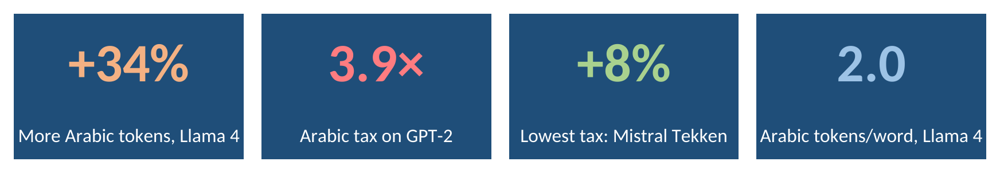

</div>

> Every chart here is a **native Excel chart** from [`excel/arabic_token_tax.xlsx`](excel/arabic_token_tax.xlsx). Every number comes from running real tokenizers on real text.

## Contents

- [Why this matters](#why-this-matters)
- [Key results](#key-results)
- [What is a token, and why languages differ](#what-is-a-token-and-why-languages-differ)
- [The math](#the-math)
- [Method](#method)
- [Result gallery](#result-gallery)
- [Arabic in depth](#arabic-in-depth)
- [Practical tips for Arabic users and developers](#practical-tips-for-arabic-users-and-developers)
- [Measure Claude yourself](#measure-claude-yourself)
- [Using the Excel workbook](#using-the-excel-workbook)
- [Run it](#run-it)
- [Project layout](#project-layout)
- [FAQ](#faq)
- [Glossary](#glossary)
- [Limits](#limits)
- [Further reading](#further-reading)

## Why this matters

Language models read text as **tokens**, and almost everything about using them is counted in tokens:

- **Price:** APIs charge per token.
- **Memory:** a context window holds a fixed number of tokens, so a language that needs more tokens fits less text.
- **Speed:** a model writes one token at a time, so more tokens means slower answers.

If the same message takes 34% more tokens in Arabic than in English, an Arabic speaker pays 34% more, waits longer and fits less text in the same window, for exactly the same meaning. Researchers call this gap **tokenization unfairness** or a lack of **tokenization parity**. This project measures it for Arabic and 23 other languages.

## Key results

The same document, the Universal Declaration of Human Rights, in English and Arabic:

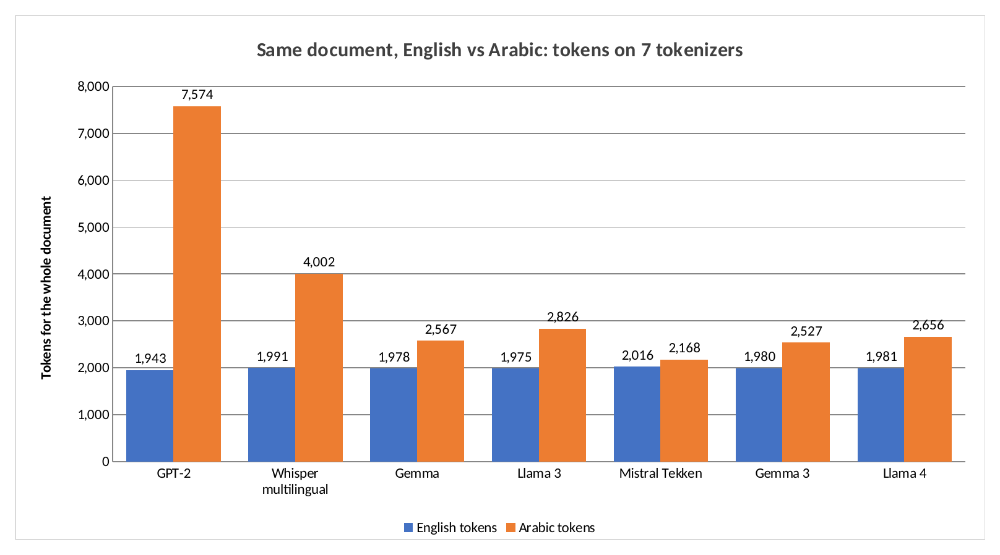

| Tokenizer | Year | Vocabulary | English tokens | Arabic tokens | Arabic ÷ English |
|---|---:|---:|---:|---:|---:|
| GPT-2 | 2019 | 50,256 | 1,943 | 7,574 | **3.90×** |
| Whisper multilingual | 2022 | 50,257 | 1,991 | 4,002 | 2.01× |
| Gemma | 2024 | 256,000 | 1,978 | 2,567 | 1.30× |
| Llama 3 | 2024 | 128,000 | 1,975 | 2,826 | 1.43× |
| Mistral Tekken | 2024 | 130,072 | 2,016 | 2,168 | **1.08×** |
| Gemma 3 | 2025 | 262,144 | 1,980 | 2,527 | 1.28× |
| Llama 4 | 2025 | 200,000 | 1,981 | 2,656 | 1.34× |

What this shows:

- **Arabic still costs more on every tokenizer tested,** from 8% more on Mistral Tekken to 290% more on GPT-2.
- **Older tokenizers were extreme.** GPT-2 split Arabic into almost four times as many tokens, because its vocabulary has almost no Arabic in it.
- **The Arabic text is shorter, yet costs more.** It has 7,645 characters and 1,314 words against 10,637 and 1,723 in English, but needs more tokens on all seven tokenizers.
- **Vocabulary share matters most.** Mistral Tekken gives 7.3% of its vocabulary to Arabic script and has the lowest tax. GPT-2 gives 0.04% and has the highest.
- **Arabic is not the worst off.** On Llama 4 it sits between French (1.31×) and Italian (1.35×). Kurdish Sorani (1.85×), Urdu (1.94×) and Amharic (2.64×) pay far more.

## What is a token, and why languages differ

A tokenizer cuts text into pieces from a fixed list called the **vocabulary**. Most modern tokenizers use **byte pair encoding** or a close relative. Training starts from single bytes or characters and repeatedly merges the most frequent pair into a new token, until the vocabulary is full.

The result depends on the training text. If most of it is English, common English words become single tokens, while Arabic words stay split into many small pieces. Three things make Arabic harder:

1. **Script and bytes.** In UTF-8, an Arabic letter takes 2 bytes and an English letter takes 1. Byte-level tokenizers start from bytes, so Arabic starts with twice the pieces before any merging.
2. **Rich word forms.** Arabic attaches articles, prepositions, conjunctions and pronouns to the word: وبكتابهم means "and with their book". One Arabic word can carry what takes four English words, and it has many more distinct forms to learn.
3. **Less training data.** Arabic is a smaller share of web text than English, so fewer Arabic merges make it into the vocabulary.

Point 2 also explains why the Arabic document has fewer words: much of what English writes as separate words, Arabic writes as one.

## The math

**Token tax**, also called parity, for language $L$ on tokenizer $k$, with the same content $D$ in every language:

$$P_{L,k} = \frac{T_k(D_L)}{T_k(D_{\text{English}})}$$

where $T_k(x)$ is the number of tokens tokenizer $k$ produces for text $x$. $P = 1$ means no tax.

**Fertility**, the average tokens per word:

$$F_{L,k} = \frac{T_k(D_L)}{W(D_L)}$$

**Extra cost** of writing content worth $N$ English tokens in language $L$, at price $p$ per million tokens:

$$\Delta C = N\,(P_{L,k} - 1)\,\frac{p}{10^6}$$

Example: 100 million English-token-equivalents a month, written in Arabic, at $2 per million input tokens on a tokenizer with $P = 1.34$ costs $100\,000\,000 \times 0.34 \times 2 / 10^6 = \$68$ extra a month.

**Arabic share of a vocabulary:**

$$S_k = \frac{\big|\{\,v \in V_k : v \text{ contains an Arabic-script character}\}\big|}{|V_k|}$$

## Method

<p align="center">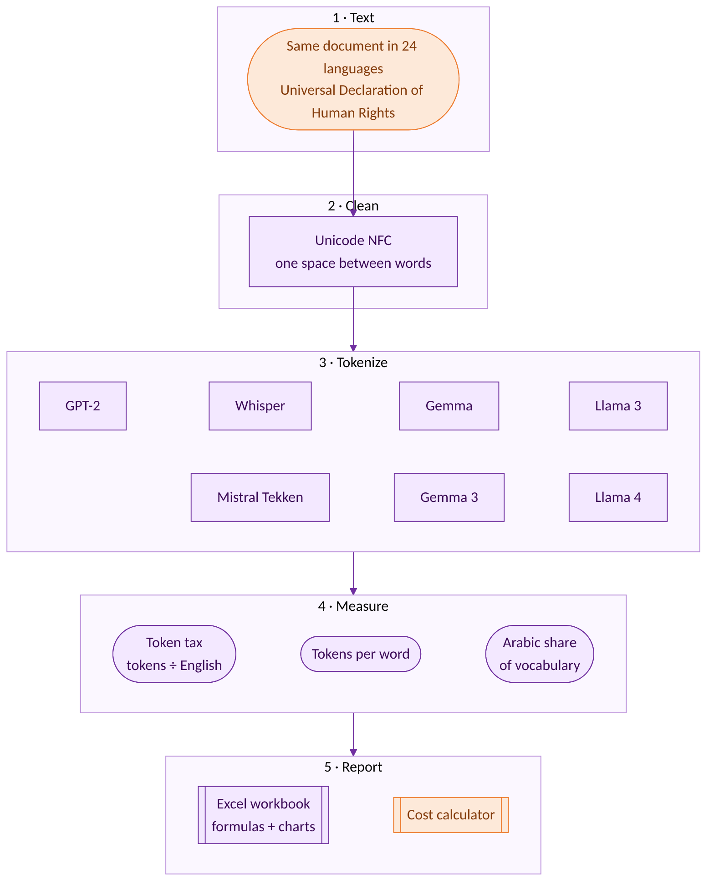</p>

| Item | Choice |
|---|---|
| Text | The Universal Declaration of Human Rights, full text in each language, from the NLTK `udhr2` corpus |
| Cleaning | Unicode NFC, all whitespace collapsed to single spaces |
| Tokenizers | 7 open tokenizers, loaded from their official files |
| Counting | Plain encoding, with no start or end tokens |
| Words | Unicode letter sequences, with marks attached |
| Dialect test | 12 everyday sentences written for this project in English, Modern Standard Arabic and Iraqi Arabic |
| Digit test | 10 numbers written with 0-9 and with Eastern Arabic digits ٠-٩ |

Why the Universal Declaration? It is one of the most translated documents in the world, the translations are official and complete, and every version carries the same meaning. That makes it a fair test of how many tokens the same content needs.

## Result gallery

### All languages, all tokenizers

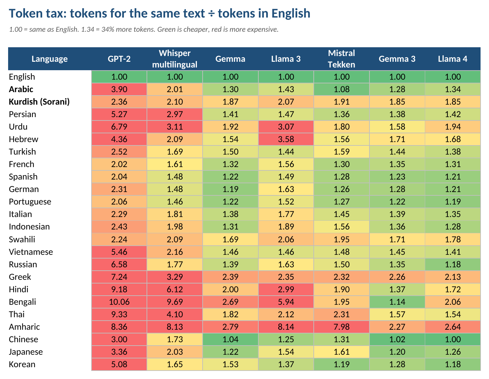

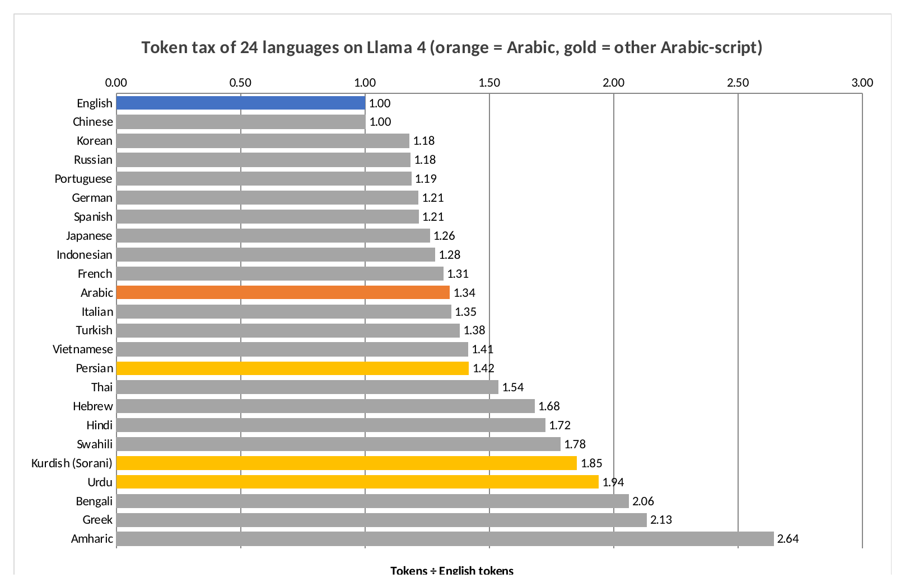

### Why some tokenizers are fairer

| Arabic in the vocabulary vs the tax | What each vocabulary is made of |
|---|---|
| 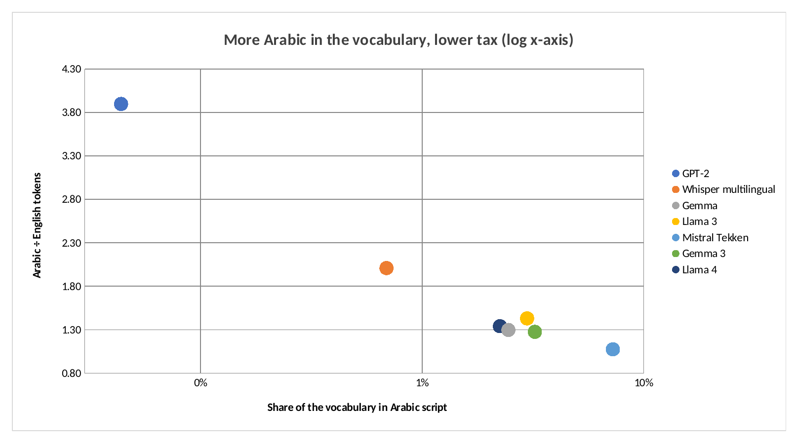 | 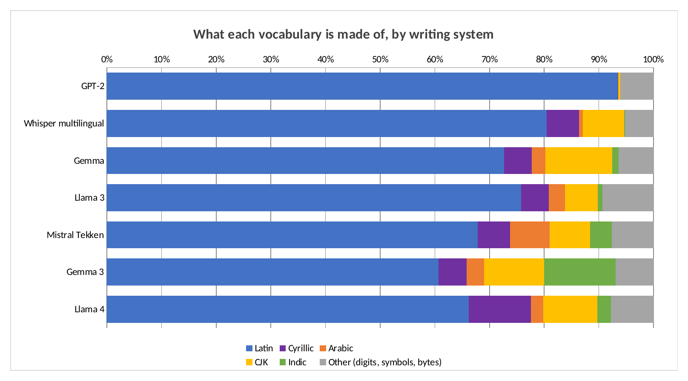 |

<p align="center">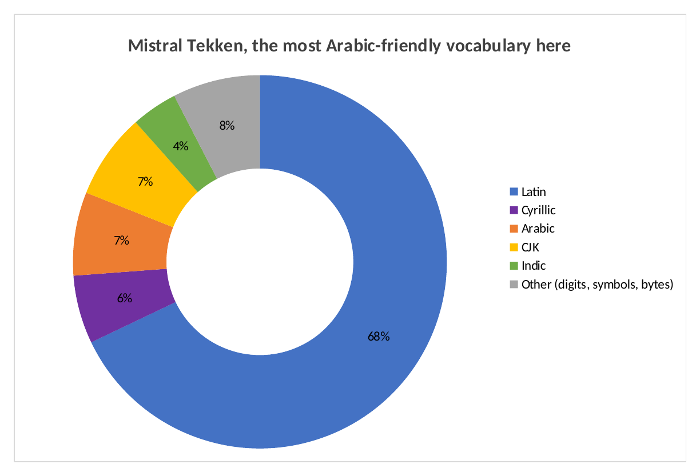</p>

### Progress over time and across the region

| From GPT-2 to Llama 4 | Languages of the region |
|---|---|
| 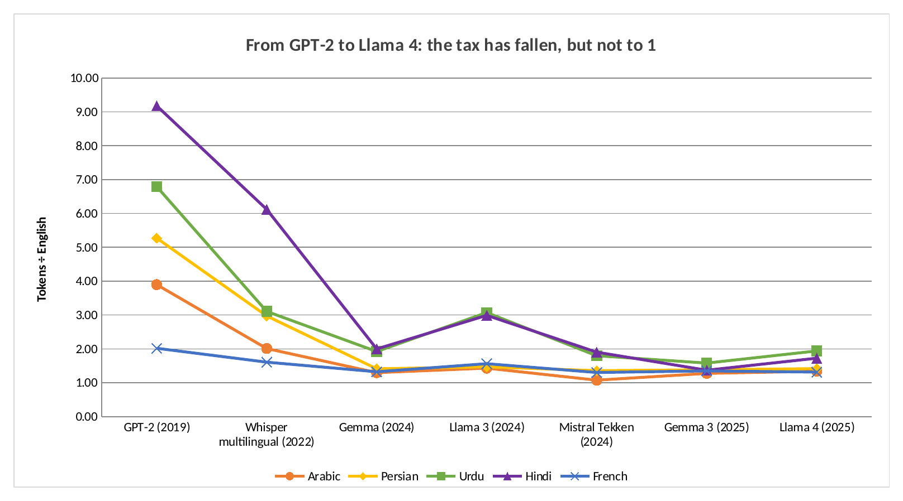 | 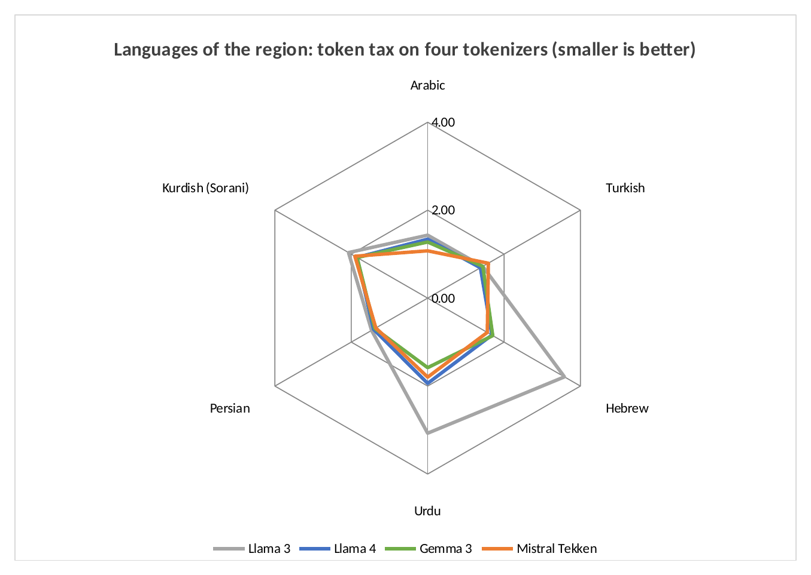 |

### Words, digits, dialects and money

| Tokens per word | Western vs Eastern Arabic digits |
|---|---|
| 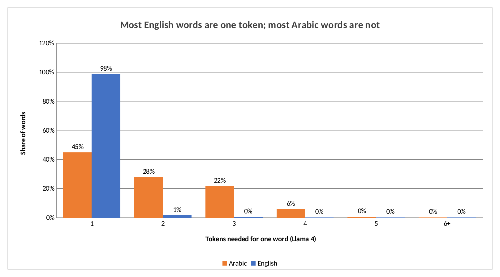 | 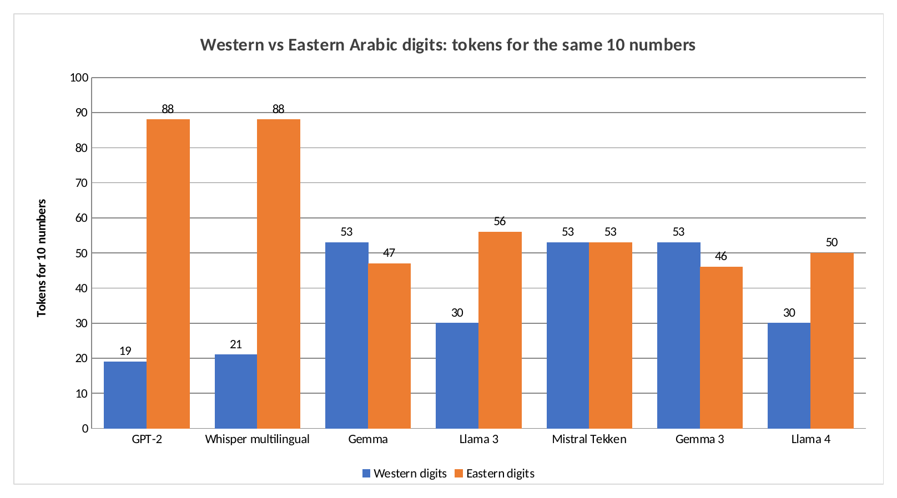 |

| Standard Arabic vs Iraqi Arabic | What the tax costs |
|---|---|
| 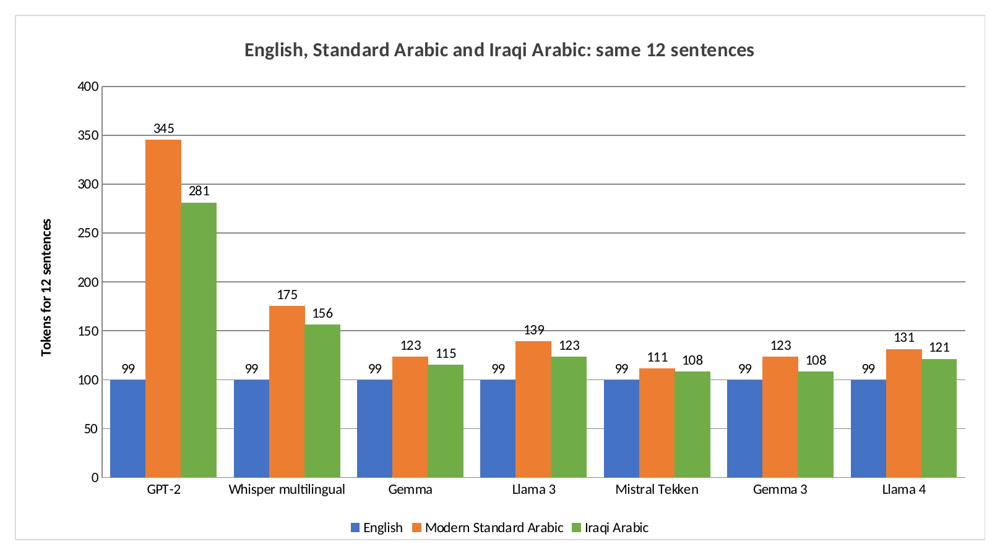 | 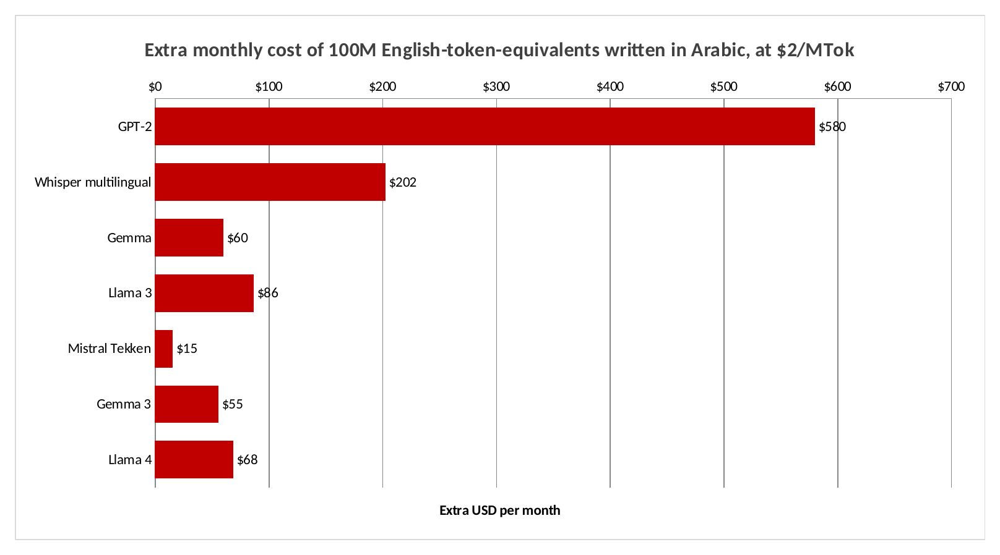 |

## Arabic in depth

**Tokens per word.** On Llama 4, 98% of English words are a single token. Only 45% of Arabic words are; 28% need two tokens and 22% need three. On average an Arabic word costs 2.02 tokens against 1.15 for English, but each Arabic word also carries more meaning.

**Vocabulary size is not enough.** Llama 4 has a larger vocabulary than Llama 3 (200,000 against 128,000) but a smaller Arabic share (2.2% against 3.0%). It still has a lower Arabic tax, 1.34× against 1.43×. The Arabic share alone does not decide the tax: vocabulary size and splitting rules matter too. Gemma 3 has the largest vocabulary, 262,144, and a 1.28× tax.

**Digits.** The same 10 numbers cost 30 tokens with 0-9 on Llama 3 and Llama 4, but 56 and 50 tokens with Eastern Arabic digits. On GPT-2 and Whisper the gap is 19 against 88 and 21 against 88. On Gemma and Gemma 3, Eastern digits are slightly cheaper (47 and 46 against 53), and on Mistral Tekken they cost the same. Gemma, Gemma 3 and Tekken split 0-9 into single digits, which explains their higher count for Western digits.

**Dialect.** In the 12-sentence sample, Iraqi Arabic needed fewer tokens than Modern Standard Arabic on all seven tokenizers, for example 121 against 131 on Llama 4. The Iraqi sentences are shorter, as everyday speech often is. English needed 99 tokens on every tokenizer. The sample is small and written for this project, so treat it as an illustration.

**Other Arabic-script languages pay more than Arabic.** On Llama 4, Persian pays 1.42×, Kurdish Sorani 1.85× and Urdu 1.94×. They share the script but have less training data than Arabic.

## Practical tips for Arabic users and developers

1. **Measure before you budget.** Run your real Arabic prompts through the tokenizer of the model you will use. The tax ranges from 8% to 290% across the tokenizers here.
2. **Use Western digits 0-9 in prompts** when you can. They were cheaper or equal on five of the seven tokenizers.
3. **Consider writing long fixed instructions in English** and asking for the answer in Arabic, after checking that answer quality holds. System prompts are sent with every request, so this saving repeats.
4. **Keep fixed Arabic text in a cached prefix.** If your API supports prompt caching, a long Arabic system prompt read from the cache costs a fraction of the normal price.
5. **Budget context in tokens, not pages.** A 100-page Arabic document fills more of the context window than a 100-page English one.
6. **Do not remove Arabic diacritics just to save tokens.** Most modern Arabic text has very few, and they can carry meaning.
7. **Compare models on your own data.** A model with a fairer tokenizer can be cheaper for Arabic even if its price per token is higher.

## Measure Claude yourself

Claude's tokenizer is not public, so it is not in the tables above. Anthropic offers a free token counting endpoint, and `count_claude.py` uses it to measure the same documents with your own API key:

```bash
pip install anthropic
export ANTHROPIC_API_KEY=your-key
python count_claude.py --model claude-sonnet-5-5
```

It prints the tokens for English, Arabic, Kurdish Sorani and Persian, and the ratio to English. This script was not run while building this project, because no API key was used.

## Using the Excel workbook

Open [`excel/arabic_token_tax.xlsx`](excel/arabic_token_tax.xlsx):

| Sheet | What it holds |
|---|---|
| Overview | Four headline numbers |
| Cost Calculator | **Your inputs** in blue: monthly content and price. Extra cost for each tokenizer updates live |
| Parity | The heatmap, all formulas from the Tokens sheet |
| Chart sheets | 11 native Excel charts |
| Tokens | The measured token counts, characters, bytes and words |
| Data sheets | The tables behind each chart |

## Run it

```bash
pip install -r requirements.txt
python download.py               # tokenizer files and the text, into data/
python -m tax.measure            # all measurements -> results/measurements.json
python build_excel.py            # workbook with formulas and charts
python render_excel_charts.py    # chart images, needs LibreOffice
pytest tests
```

The whole measurement takes a few seconds on a laptop.

## Project layout

```text
tax/tokenizers.py           Loads the 7 tokenizers
tax/measure.py              Every measurement in this README
download.py                 Fetches tokenizer files and the text
count_claude.py             Same test on Claude with your API key
data_samples/               The English, Standard Arabic and Iraqi sentences
xlkit/charts.py             Excel chart helpers and the renderer
build_excel.py              Builds the workbook
render_excel_charts.py      Exports chart images
results/                    measurements.json and all images
excel/arabic_token_tax.xlsx
```

## FAQ

**Does a higher token count mean the model understands Arabic worse?**
Not directly. This project measures cost and length, not quality. Some research links heavy splitting to weaker performance, but that is not tested here.

**Why is Chinese at 1.0 on Llama 4?**
Chinese packs a lot of meaning into each character, and Llama 4 has many Chinese tokens, so the same document needs about as many tokens as English.

**Why not GPT-4o or Claude?**
GPT-4o's tokenizer files could not be downloaded in the environment used to build this, and Claude's tokenizer is not public. `count_claude.py` covers Claude through the official API.

**Is the Universal Declaration typical text?**
It is formal legal language. Chat messages, code or news may give different ratios, so measure your own text for exact numbers.

## Glossary

| Term | Meaning |
|---|---|
| Token | A piece of text from the tokenizer's vocabulary |
| Vocabulary | The fixed list of tokens a tokenizer can produce |
| BPE | Byte pair encoding: building a vocabulary by merging frequent pairs |
| Parity / token tax | Tokens in a language ÷ tokens in English for the same content |
| Fertility | Average tokens per word |
| UTF-8 | The standard way to store text as bytes; Arabic letters take 2 bytes |
| NFC | A standard Unicode form, so the same letter is always stored the same way |
| Context window | The maximum number of tokens a model can read at once |

## Limits

- **Translations are not word-for-word,** so part of each ratio comes from how the translator wrote, not only from the tokenizer.
- The test text is formal legal language. Everyday text may give different results.
- Claude and GPT-4o tokenizers are not measured.
- The Arabic vocabulary share counts tokens that decode to text with an Arabic character. Byte pieces that are only part of a character are not counted.
- The dialect sample is 12 sentences written for this project, which is too small for firm conclusions.
- Tokenizer files keep their own licenses and are downloaded by `download.py`, not stored in this repository.

## Further reading

- Petrov, La Malfa, Torr and Bibi, [Language Model Tokenizers Introduce Unfairness Between Languages](https://arxiv.org/abs/2305.15425), NeurIPS 2023, which introduced tokenization parity.
- [Anthropic token counting](https://platform.claude.com/docs/en/build-with-claude/token-counting)

## Author

**Jaafar Salim**, University of Technology, Iraq
